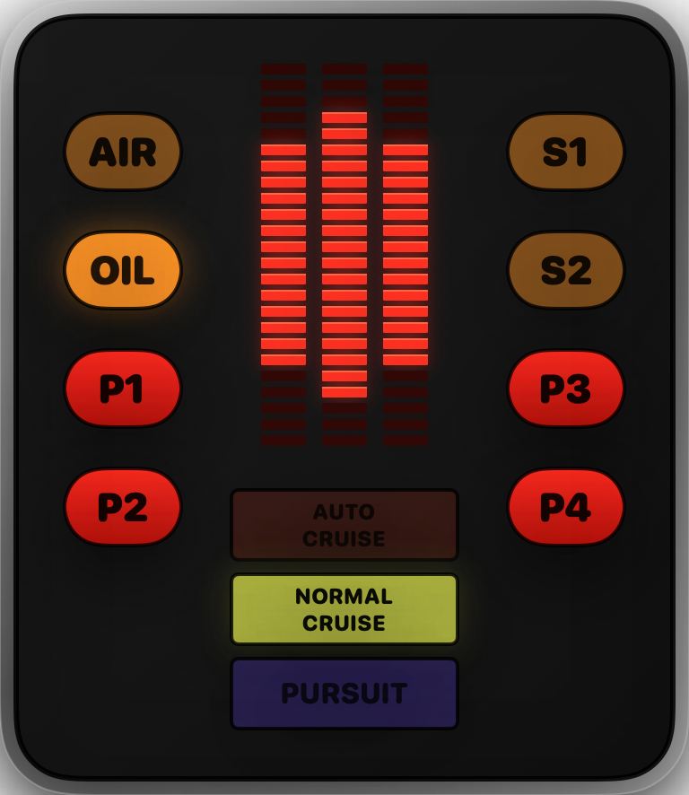
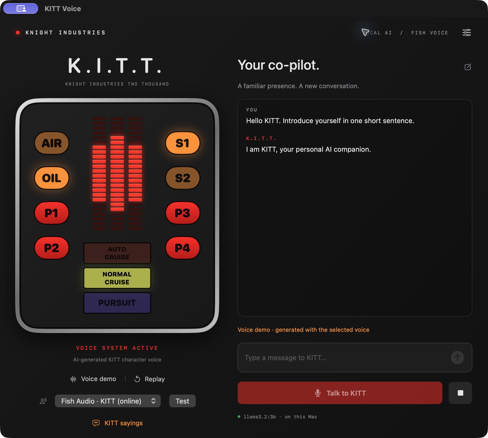

# KITT Voice for Mac

A native Swift app for Apple Silicon Macs running macOS 14 or later, with
local AI conversations, speech and a red LED voice panel.

## Screenshots

### Compact voice box

The compact panel keeps the animated voice LEDs and dashboard controls visible.

### Full conversation interface

The full interface adds the conversation, message entry, voice selection and
speech controls. The screenshot shows an example conversation.

## Install from source

1. Clone or download this repository.
2. Install Xcode command-line tools, then run `./build.command`.
3. Double-click **KITT Voice.app** in the repository folder.
4. Use the app's **Set up free AI** control to install/configure local Ollama
   and its chat model as prompted.
5. Built-in Mac voices work immediately. For optional Kokoro voices, install
   Python 3.12 or 3.13 and run `./setup-voices.command`.

Keep **VoiceEngine** beside the app. Python environments, downloaded models,
API keys and conversation history are excluded from the repository. A compiled
app is also available under Releases. Extract its complete folder before
opening the app; local ad-hoc signing is used, without Apple notarization.

## Talk and listen

- The app opens as **only the voice box**, with a compact red LED panel. Drag the black panel to move it; drag a corner to resize it. The conversation and other controls stay hidden.
- **Hands-free conversation is on by default.** Speak normally. After about 1.5 seconds of silence, KITT sends your words to local AI and speaks the reply automatically. He starts listening again after the reply. There is no need to press Talk or Send.
- Settings opens in a normal Mac window. Close it with **Done**, **Escape**, or the **red close button**. If the Fish key is missing, Settings stays closed and listening waits until you add a key or choose a local voice.
- Drag the silver bezel or any empty part of the panel to move the voice box. Buttons keep their normal actions and do not start a drag.
- The microphone pauses while KITT is thinking or speaking, and while Settings or the sayings panel is open, so the app does not hear its own voice.
- Click **AIR** to pause or resume hands-free listening. **P2** stops the current reply and pauses listening. **P3** opens Settings. A lit AIR lamp means the microphone is listening.
- In **P3 → Hands-free conversation**, adjust the pause before a reply (0.9–3 seconds), turn automatic listening on or off, and switch between the compact panel and full interface.
- Right-click the panel for Settings, sayings, the full interface, and Quit. The macOS **View** menu offers the same view controls; **⌘L** pauses/resumes listening, **⌘1** shows the voice box, **⌘2** shows the full interface.
- If you prefer typing, pause listening and use the full interface. Type a message and press Return. Manual **Talk** and **Finish & send** also remain available when hands-free mode is off.
- Allow microphone and speech recognition when macOS asks. Speech recognition is restricted to Apple's on-device mode. If your Mac cannot provide it, type instead.
- The AI runs through local Ollama, using the downloaded `llama3.2:3b` model. It needs no API key or subscription. If disconnected, click **Set up free AI**.
- The three red LED stacks follow the actual sound being played. Left and right move together at the same height, with a taller centre stack. They go dark during silence. There is no scanner animation.
- Change the voice in **P3 → Speech**. Settings also contains speed and volume controls. The full interface retains its voice picker and Test button.
- Open **KITT sayings** for classic short phrases and original KITT-inspired quips. These are generated speech, not television audio clips.
- **Stop**, P2, or Escape in the full interface ends playback, listening, or a pending reply and pauses hands-free mode. **New conversation** clears this app's in-memory conversation. Chat is not routinely saved to disk; a one-time temporary handoff can preserve the current session during an app update, and is removed after reading.

## Voices

**Kokoro** voices run entirely on this Mac, without a key. Michael, Fenrir, Puck and Onyx are American male voices; George is British; Heart is an American female voice. Installed Mac voices are also available. These are approximations of character and tone, not the original KITT actor.

**Fish Audio · KITT (online)** uses the community voice model: [KITT by Polybius223](https://fish.audio/m/eaa8a416bfcd4a38b3e3fa94ad934225/).

1. Get a key at [Fish Audio API keys](https://fish.audio/app/api-keys).
2. Open Settings and paste it into the secure **Fish Audio API key** field.
3. Press **Use & test Fish KITT voice**. The key works for the current session. Press **Save in Keychain** yourself if you want it remembered; the app never writes it into source code or preferences.

Fish receives the reply or phrase text used for synthesis. Its free tier may retain requests for model improvement. The AI chat model still runs locally. The Fish integration explicitly requests `s2.1-pro-free`, has no paid-model fallback, and blocks requests after the currently announced free period ends on 30 November 2026. Account access, voice availability, and fair-use limits are controlled by Fish. Local voices remain usable without Fish.

Free availability was checked on 24 October 2026: [Fish free API announcement](https://fish.audio/blog/s2-1-pro-free-api/), [pricing](https://docs.fish.audio/developer-guide/models-pricing/pricing-and-rate-limits), [TTS API](https://docs.fish.audio/api-reference/endpoint/openapi-v1/text-to-speech).

## Panel controls

| Control | Function |
|---|---|
| P1 | Voice demo |
| AIR | Pause/resume hands-free listening; lit while microphone is active |
| P2 | Stop speech and pause hands-free listening |
| P3 | Settings |
| P4 | Replay the last AI answer |
| OIL | Local AI connected |
| S1 | Speech output active |
| S2 | AI processing |
| Auto Cruise | Relaxed conversation style |
| Normal Cruise | Calm, precise style |
| Pursuit | Energetic, concise style |

The panel does not control a real vehicle. The AI has no access to files, apps, live web search, or other devices.

## Rebuild

`build.command` rebuilds and locally signs the app using the installed Xcode command-line tools. Source is in `Source/`. The app uses SwiftUI, AVFoundation, and Speech; no web frontend or paid service is required for local mode.

Create the optional local voice environment on each Mac using `setup-voices.command`; it is not included in the repository or release. Keep the full folder together. Ollama stores the separate AI chat model in its own managed model directory; it is not included in this folder.

## Credits

Unofficial personal fan project, not affiliated with Knight Rider, its rights holders, or Fish Audio. Kokoro is an independent open model. See `VoiceEngine/NOTICE.md` for sources and licenses. Classic short phrases were checked against scripts in the [Knight Rider Archives](https://www.knightriderarchives.com/knight_rider/season_two/a_knight_in_shining_armor/scripts/1/), [Trust Doesn't Rust](https://knightriderarchives.com/knight_rider/season_one/trust_doesnt_rust/scripts/9/), and [Goliath Returns](https://www.knightriderarchives.com/knight_rider/season_two/goliath_returns/scripts/1/), and the [Mouth of the Snake transcript](https://www.springfieldspringfield.co.uk/view_episode_scripts.php?episode=s02e21&tv-show=knight-rider-1982).
